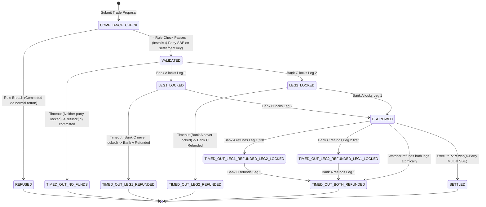

# API Contract & Technical Interface Specification: AtomicBridge

**Corridor Jurisdictions**: India & Singapore  
**Regulators**: Reserve Bank of India (RBI) & Monetary Authority of Singapore (MAS)  
**Selected Demo Token Pair**: INR and USD (Optional UI labels: eINR / eUSD; amounts such as ₹84M INR and \$1M USD are sample demo terms)  
**Target Platform & Exact Package Status**:
- Hyperledger Fabric: **v2.5 LTS** (External Chaincode / CCaaS architecture)
- `fabric-shim`: **`2.5.6`** (installed in `app/chaincode/node_modules/fabric-shim`)
- `fabric-contract-api`: **`2.5.6`** (installed in `app/chaincode/node_modules/fabric-contract-api`)
- `@hyperledger/fabric-protos`: **`0.2.1`** (installed in `app/chaincode/node_modules/@hyperledger/fabric-protos`)
- `@hyperledger/fabric-gateway`: **Not yet installed** (pending backend initialization; target is v1.x, Node.js `>=20`)
- **Code Snippet Verification Status**: TypeScript SBE and Gateway code snippets below are **illustrative design snippets (uncompiled)** and have not yet been compiled or executed against the project build pipeline.

---

## 1. Trade Lifecycle & Complete Timeout State Model (Approach B)



### 1.1 Complete Status Definitions

| Status | Code | Lifecycle Category | Ledger Commitment & Refund Impact |
| :--- | :--- | :--- | :--- |
| `INITIATED` | `100` | Inception | Intermediate proposal state. |
| `VALIDATED` | `110` | Active | Passed compliance. SBE installed on `settlement:{tradeId}`. |
| `REFUSED` | `400` | **Terminal** | Failed compliance. Committed on ledger with reason code. |
| `LEG1_LOCKED` | `200` | Active | Bank A INR leg locked in `escrow:leg1:{tradeId}`. |
| `LEG2_LOCKED` | `205` | Active | Bank C USD leg locked in `escrow:leg2:{tradeId}`. |
| `ESCROWED` | `210` | Active | Both legs locked. Awaiting 4-party mutual settlement. |
| `SETTLED` | `300` | **Terminal** | Swapped atomically with 4-party SBE on `settlement:{tradeId}`. Refunds barred. |
| `TIMED_OUT_NO_FUNDS` | `410` | **Terminal** | Timed out before any bank locked funds. `refund:{id}` committed. Zero loss. |
| `TIMED_OUT_LEG1_REFUNDED` | `420` | **Terminal** | Only Bank A locked; timeout reached; Bank A 100% refunded. `refund:{id}` committed. |
| `TIMED_OUT_LEG2_REFUNDED` | `425` | **Terminal** | Only Bank C locked; timeout reached; Bank C 100% refunded. `refund:{id}` committed. |
| `TIMED_OUT_LEG1_REFUNDED_LEG2_LOCKED` | `428` | **Intermediate** | Both locked; Bank A refunded its leg first; Bank C USD leg remains locked. |
| `TIMED_OUT_LEG2_REFUNDED_LEG1_LOCKED` | `429` | **Intermediate** | Both locked; Bank C refunded its leg first; Bank A INR leg remains locked. |
| `TIMED_OUT_BOTH_REFUNDED` | `430` | **Terminal** | Both locked; swap failed/timed out; both 100% refunded. `refund:{id}` committed. |
| `FAILED` | `500` | System Rejection | MVCC collision or invalid endorsement. Dropped by Fabric (no write). |

---

## 2. Concrete State Key Layout: Consensus Policy vs. Client Authorization

The default channel chaincode endorsement policy is:
$$\text{Policy}_{\text{chaincode}} = \text{OR}('BankA\text{-}MSP.peer', 'BankC\text{-}MSP.peer', 'RBI\text{-}MSP.peer', 'MAS\text{-}MSP.peer')$$

* **Consensus-Layer Meaning**: This policy allows **ANY ONE of those four peer organizations** to satisfy default endorsement for any key that does not have an SBE policy attached.
* **Execution-Layer Meaning**: `ctx.clientIdentity.getMSPID()` restricts **which client identity may invoke the function**. It does **not** require that client's organization peer to endorse.
* **Confirmation for PoC**: The **Client-Identity Authorization Model** is the intended PoC behavior for `MintTokens`, `SetJurisdictionRule`, `LockTradeLeg`, and refunds under the default `OR(...)` policy. Only `settlement:{tradeId}` enforces consensus-layer peer endorsement via SBE.

| State Key Pattern | Written By Method | Read By Method | Fabric Consensus Endorsement (VSCC) | Chaincode Client-Identity Authorization | SBE Installed? |
| :--- | :--- | :--- | :--- | :--- | :--- |
| `balance:{ownerMSP}:{currency}` | `MintTokens`, `BurnTokens`, `LockTradeLeg`, `ExecutePvPSwap`, `CancelOrRefundTrade` | `GetBalance`, `LockTradeLeg`, `ExecutePvPSwap` | **Default Policy**: `OR(BankA, BankC, RBI, MAS)` (Any 1 peer) | • `Mint`: `caller === Regulator`<br>• `Burn`/`Lock`: `caller === ownerMSP`<br>• `Refund`: `caller === ownerMSP \|\| Watcher` | **No** (Account-based model) |
| `rule:{jurisdiction}` | `SetJurisdictionRule` | `InitiateTrade`, `GetJurisdictionRule` | **Default Policy**: `OR(BankA, BankC, RBI, MAS)` | `caller === RBI-MSP` (India) or `caller === MAS-MSP` (Singapore) | **No** |
| `trade:terms:{tradeId}` | `InitiateTrade` | `LockTradeLeg`, `ExecutePvPSwap`, `CancelOrRefundTrade` | **Default Policy**: `OR(BankA, BankC, RBI, MAS)` | `caller === InitiatorBank` | **No** (Immutable Header) |
| `compliance:{tradeId}` | `InitiateTrade` (on refusal) | Audit queries | **Default Policy**: `OR(BankA, BankC, RBI, MAS)` | `caller === InitiatorBank` | **No** |
| **`settlement:{tradeId}`** | • **Create (`PENDING`)**: `InitiateTrade`<br>• **Mutate (`SETTLED`)**: `ExecutePvPSwap` | `ExecutePvPSwap`, `CancelOrRefundTrade` | • **Create**: Default `OR(...)`<br>• **Mutate**: **4-Party Mutual SBE**<br>$\text{AND}(BankA, BankC, RBI, MAS)$ | • `Create`: `caller === InitiatorBank`<br>• `Settle`: Verified across 4 peers | **YES** (Installed during `InitiateTrade`) |
| `escrow:leg1:{tradeId}` | • **Lock**: `LockTradeLeg`<br>• **Release**: `ExecutePvPSwap`<br>• **Refund**: `CancelOrRefundTrade` | `ExecutePvPSwap`, `CancelOrRefundTrade` | **Default Policy**: `OR(BankA, BankC, RBI, MAS)` | • `Lock`: `caller === BankA-MSP`<br>• `Refund`: `caller === BankA-MSP \|\| Watcher` | **No** |
| `escrow:leg2:{tradeId}` | • **Lock**: `LockTradeLeg`<br>• **Release**: `ExecutePvPSwap`<br>• **Refund**: `CancelOrRefundTrade` | `ExecutePvPSwap`, `CancelOrRefundTrade` | **Default Policy**: `OR(BankA, BankC, RBI, MAS)` | • `Lock`: `caller === BankC-MSP`<br>• `Refund`: `caller === BankC-MSP \|\| Watcher` | **No** |
| **`refund:{tradeId}`** | `CancelOrRefundTrade` | Audit queries, UI status aggregator | **Default Policy**: `OR(BankA, BankC, RBI, MAS)` | `caller === DepositorBank \|\| Watcher` | **No** |

---

## 3. Refund Architecture (Approach B), Duplicate Prevention & Guards

### 3.1 Approach B Ledger Mechanics
1. **The SBE Invariant**: `settlement:{tradeId}` is **never modified** by a unilateral refund; it remains in its initial `PENDING` state.
2. **Outcome Record**: A separate state key `refund:{tradeId}` is written by `CancelOrRefundTrade` under the default channel endorsement policy `OR(...)`.
3. **Data Model**:
   ```typescript
   export interface RefundRecord {
     docType: 'refund_record';
     tradeId: string;
     outcome: 'TIMED_OUT_NO_FUNDS' | 'TIMED_OUT_LEG1_REFUNDED' | 'TIMED_OUT_LEG2_REFUNDED' | 'TIMED_OUT_LEG1_REFUNDED_LEG2_LOCKED' | 'TIMED_OUT_LEG2_REFUNDED_LEG1_LOCKED' | 'TIMED_OUT_BOTH_REFUNDED';
     leg1Refunded: boolean;
     leg2Refunded: boolean;
     refundedAt: string;
     refundTxId: string;
   }
   ```

### 3.2 Exact Guards & Duplicate Refund Prevention
Inside `CancelOrRefundTrade(ctx, tradeId)`:
1. **Settlement Check**: If `settlement.status === 'SETTLED'`, throws `Error: Trade already settled; refunds are forbidden`.
2. **Cut-off Check**: If `txTimestamp < terms.expiresAt`, throws `Error: Trade has not reached cut-off time`.
3. **Existing Terminal Refund Check**:
   If `refund:{tradeId}` already exists:
   - If `refund.outcome === 'TIMED_OUT_NO_FUNDS'`, throws `Error: Trade already timed out with no funds locked (TIMED_OUT_NO_FUNDS)`.
   - If `refund.outcome === 'TIMED_OUT_BOTH_REFUNDED'`, throws `Error: Trade is already fully refunded (TIMED_OUT_BOTH_REFUNDED)`.
   - If caller is `BankA-MSP` and `refund.leg1Refunded === true`, throws `Error: Leg 1 is already refunded`.
   - If caller is `BankC-MSP` and `refund.leg2Refunded === true`, throws `Error: Leg 2 is already refunded`.
4. **Case 1: No Escrows Locked**:
   - If neither `escrow:leg1` nor `escrow:leg2` is in `LOCKED` status (and neither was ever locked):
     - Commits `refund:{tradeId}` with `outcome: 'TIMED_OUT_NO_FUNDS'`, `leg1Refunded: false`, `leg2Refunded: false`.
     - No balance keys are mutated.
5. **Case 2: Escrow Locked (Partial or Mutual)**:
   - **Amounts**: Values are strictly read from `trade:terms:{tradeId}` (`terms.leg1AmountINR`, `terms.leg2AmountUSD`), never accepted from unverified caller arguments.
   - **Sequential Refund Order 1 (Bank A first)**:
     - Bank A refunds `Leg 1` if `escrow:leg1.status === 'LOCKED'`, sets it to `REFUNDED`, credits Bank A balance with `terms.leg1AmountINR`.
       - If Leg 2 was also locked: commits `outcome: 'TIMED_OUT_LEG1_REFUNDED_LEG2_LOCKED'`.
       - If Leg 2 was never locked: commits `outcome: 'TIMED_OUT_LEG1_REFUNDED'`.
     - When Bank C later refunds `Leg 2`: sets it to `REFUNDED`, credits Bank C balance with `terms.leg2AmountUSD`, updates `refund:{tradeId}` to `outcome: 'TIMED_OUT_BOTH_REFUNDED'`.
   - **Sequential Refund Order 2 (Bank C first)**:
     - Bank C refunds `Leg 2` if `escrow:leg2.status === 'LOCKED'`, sets it to `REFUNDED`, credits Bank C balance with `terms.leg2AmountUSD`.
       - If Leg 1 was also locked: commits `outcome: 'TIMED_OUT_LEG2_REFUNDED_LEG1_LOCKED'`.
       - If Leg 1 was never locked: commits `outcome: 'TIMED_OUT_LEG2_REFUNDED'`.
     - When Bank A later refunds `Leg 1`: sets it to `REFUNDED`, credits Bank A balance with `terms.leg1AmountINR`, updates `refund:{tradeId}` to `outcome: 'TIMED_OUT_BOTH_REFUNDED'`.
   - **Atomic Mutual Refund by Watcher**: Refunds both legs in one transaction, crediting both banks and committing `outcome: 'TIMED_OUT_BOTH_REFUNDED'`.
   - **Watcher Handling of Partially-Refunded Trades**: If the watcher finds one leg already `REFUNDED` (i.e., `refund:{tradeId}` exists with intermediate outcome `TIMED_OUT_LEG1_REFUNDED_LEG2_LOCKED` or `TIMED_OUT_LEG2_REFUNDED_LEG1_LOCKED`), it refunds **only the remaining `LOCKED` leg**, never crediting an already-refunded leg twice, and updates `refund:{tradeId}` to `outcome: 'TIMED_OUT_BOTH_REFUNDED'`.

### 3.3 UI Status Derivation & Local Clock Disclaimer
> [!IMPORTANT]
> **Browser Local Clock Disclaimer**: Browser/client timers based on local clocks are strictly **estimates**. The UI displays an estimated countdown, but **only shows a confirmed timeout or refund status after the corresponding transaction commits on the ledger**.

The UI determines the display status in priority order:
1. If `settlement:{tradeId}` exists with `status === 'SETTLED'` $\rightarrow$ **`SETTLED`** (Ledger-Confirmed).
2. Else if `refund:{tradeId}` exists $\rightarrow$ displays `refund.outcome` directly:
   - `TIMED_OUT_NO_FUNDS`
   - `TIMED_OUT_LEG1_REFUNDED`
   - `TIMED_OUT_LEG2_REFUNDED`
   - `TIMED_OUT_LEG1_REFUNDED_LEG2_LOCKED` (Partially Refunded; Leg 2 Pending)
   - `TIMED_OUT_LEG2_REFUNDED_LEG1_LOCKED` (Partially Refunded; Leg 1 Pending)
   - `TIMED_OUT_BOTH_REFUNDED` (Fully Refunded)
3. Else if current local browser time $\ge$ `terms.expiresAt` $\rightarrow$ **`[ESTIMATED EXPIRY: Local timer elapsed; awaiting ledger refund confirmation]`**.
4. Else $\rightarrow$ displays active pre-expiry progress (`VALIDATED`, `LEG1_LOCKED`, `LEG2_LOCKED`, or `ESCROWED`).

---

## 4. Refund Caller Identities & Timestamp Trust Limitations

### 4.1 Authorized Callers
`CancelOrRefundTrade` may be invoked exclusively by:
* **The Depositing Bank** (`BankA-MSP` for Leg 1, `BankC-MSP` for Leg 2): Authorized to unilaterally reclaim its own locked escrow post-deadline.
* **The Authorized Expiry Watcher**: A background service operating under an existing regulator MSP (`RBI-MSP` or `MAS-MSP`) with the certificate attribute `atomicbridge.role=expiry-watcher`. Chaincode verifies both the MSP membership and the attribute (see requirements.md §2.1.5). (**PoC simplification**: attribute check not enforced; any `RBI-MSP` or `MAS-MSP` client may act as watcher.)

### 4.2 Timestamp Trust Limitations
* Fabric proposal timestamps (`ctx.stub.getTxTimestamp()`) are **supplied by the client application** in the signed proposal header (`ChannelHeader.timestamp`).
* Fabric peers do **not** supply an independent distributed consensus wall clock or BFT time oracle.
* **Crucial Limitation**: The proposal timestamp alone does **not independently prove real-world wall-clock expiry**. A malicious or skewed client could submit an artificial timestamp.
* **PoC Trust Assumption**: The consortium explicitly relies on the assumption that authorized client applications (member bank backends and the authorized expiry watcher) are honest and operate system clocks synchronized via NTP.
* **Deterministic Chaincode Guard**: Chaincode strictly rejects any refund proposal where `txTimestamp < terms.expiresAt`.

---

## 5. Illustrative Design Snippets (Uncompiled)

> [!NOTE]
> The TypeScript snippets below illustrate the intended API patterns for `fabric-shim@2.5.6` and `@hyperledger/fabric-gateway` v1.x. They are **illustrative design snippets (uncompiled)** and have not yet been compiled or executed against the project build pipeline.

### 5.1 Illustrative Chaincode SBE Installation (`fabric-shim@2.5.6`)

```typescript
import { Context, Contract } from 'fabric-contract-api';
import { KeyEndorsementPolicy } from 'fabric-shim';

export class AtomicBridgeContract extends Contract {

  // Phase 1: Initiating trade and installing 4-party SBE on settlement key
  public async InitiateTrade(
    ctx: Context,
    tradeId: string,
    counterpartyMSP: string,
    leg1AmountINR: number,
    leg2AmountUSD: number,
    timeoutSeconds: number
  ): Promise<string> {
    const callerMSP = ctx.clientIdentity.getMSPID();
    const txTime = new Date(ctx.stub.getTxTimestamp().seconds.low * 1000);
    const txTimestamp = txTime.toISOString();
    
    // Evaluate compliance rules
    const compliancePass = await this.evaluateRules(ctx, leg1AmountINR, leg2AmountUSD);
    if (!compliancePass.valid) {
      const refusalRecord = {
        docType: 'compliance_attempt',
        attemptId: ctx.stub.getTxID(),
        tradeId,
        initiatorMSP: callerMSP,
        counterpartyMSP,
        evaluatedAt: txTimestamp,
        result: 'REFUSED',
        reasonCode: compliancePass.reasonCode,
      };
      await ctx.stub.putState(`compliance:${tradeId}`, Buffer.from(JSON.stringify(refusalRecord)));
      ctx.stub.setEvent('TradeRefused', Buffer.from(JSON.stringify(refusalRecord)));
      return JSON.stringify({ status: 'REFUSED', reason: compliancePass.reasonCode });
    }

    // Commit immutable trade terms
    const expiresAt = new Date(txTime.getTime() + timeoutSeconds * 1000).toISOString();
    const terms = {
      docType: 'trade_terms',
      tradeId,
      initiatorMSP: callerMSP,
      counterpartyMSP,
      leg1AmountINR,
      leg2AmountUSD,
      exchangeRate: leg1AmountINR / leg2AmountUSD,
      expiresAt,
      createdAt: txTimestamp,
    };
    await ctx.stub.putState(`trade:terms:${tradeId}`, Buffer.from(JSON.stringify(terms)));

    // Create settlement key with PENDING status and install 4-party SBE
    const settlementKey = `settlement:${tradeId}`;
    const initialSettlement = { docType: 'settlement', tradeId, status: 'PENDING' };
    await ctx.stub.putState(settlementKey, Buffer.from(JSON.stringify(initialSettlement)));

    const ep = new KeyEndorsementPolicy();
    ep.addOrgs('PEER', 'BankA-MSP', 'BankC-MSP', 'RBI-MSP', 'MAS-MSP');
    await ctx.stub.setStateValidationParameter(settlementKey, ep.getPolicy());

    return JSON.stringify({ status: 'VALIDATED', tradeId, expiresAt });
  }

  // Phase 2: Settlement under 4-party SBE
  public async ExecutePvPSwap(ctx: Context, tradeId: string): Promise<void> {
    const settlementKey = `settlement:${tradeId}`;
    const settlementBytes = await ctx.stub.getState(settlementKey);
    const settlement = JSON.parse(settlementBytes.toString());
    
    if (settlement.status !== 'PENDING') {
      throw new Error(`Trade ${tradeId} is not in PENDING status`);
    }

    // Mutating settlement key triggers Fabric VSCC 4-party SBE validation
    settlement.status = 'SETTLED';
    settlement.settledAt = new Date(ctx.stub.getTxTimestamp().seconds.low * 1000).toISOString();
    settlement.settlementTxId = ctx.stub.getTxID();
    await ctx.stub.putState(settlementKey, Buffer.from(JSON.stringify(settlement)));

    // Balances swap and escrows release
  }

  // Phase 3: Timeout Refund (Approach B: writes refund:{tradeId}, DOES NOT touch settlement key)
  public async CancelOrRefundTrade(ctx: Context, tradeId: string): Promise<string> {
    const callerMSP = ctx.clientIdentity.getMSPID();
    const txTime = new Date(ctx.stub.getTxTimestamp().seconds.low * 1000);
    const termsBytes = await ctx.stub.getState(`trade:terms:${tradeId}`);
    const terms = JSON.parse(termsBytes.toString());

    // 1. Settlement Invariant Guard
    const settlementBytes = await ctx.stub.getState(`settlement:${tradeId}`);
    if (settlementBytes && settlementBytes.length > 0) {
      const settlement = JSON.parse(settlementBytes.toString());
      if (settlement.status === 'SETTLED') {
        throw new Error(`Trade ${tradeId} is settled; refunds are forbidden`);
      }
    }

    // 2. Proposal timestamp validation
    if (txTime.getTime() < new Date(terms.expiresAt).getTime()) {
      throw new Error(`Trade ${tradeId} has not reached cut-off time`);
    }

    // 3. Caller authorization: Depositing bank or authorized channel watcher (RBI/MAS/BankA)
    const isLeg1Owner = (callerMSP === terms.initiatorMSP);
    const isLeg2Owner = (callerMSP === terms.counterpartyMSP);
    // Production: also check ctx.clientIdentity.getAttributeValue('atomicbridge.role') === 'expiry-watcher'
    // PoC simplification: attribute check not enforced; MSP membership alone is sufficient
    const isWatcher = (callerMSP === 'RBI-MSP' || callerMSP === 'MAS-MSP');
    if (!isLeg1Owner && !isLeg2Owner && !isWatcher) {
      throw new Error(`Unauthorized caller: ${callerMSP}`);
    }

    // 4. Check existing refund record for terminal state
    const existingRefundBytes = await ctx.stub.getState(`refund:${tradeId}`);
    let existingRefund = existingRefundBytes && existingRefundBytes.length > 0 
      ? JSON.parse(existingRefundBytes.toString()) 
      : null;

    if (existingRefund) {
      if (existingRefund.outcome === 'TIMED_OUT_NO_FUNDS') {
        throw new Error('Trade already timed out with no funds locked (TIMED_OUT_NO_FUNDS)');
      }
      if (existingRefund.outcome === 'TIMED_OUT_BOTH_REFUNDED') {
        throw new Error('Trade is already fully refunded (TIMED_OUT_BOTH_REFUNDED)');
      }
      if (existingRefund.outcome === 'TIMED_OUT_LEG1_REFUNDED' || existingRefund.outcome === 'TIMED_OUT_LEG2_REFUNDED') {
        throw new Error(`Trade refund is terminal (${existingRefund.outcome}); no further legs to refund`);
      }
      if (isLeg1Owner && existingRefund.leg1Refunded) {
        throw new Error('Leg 1 is already refunded');
      }
      if (isLeg2Owner && existingRefund.leg2Refunded) {
        throw new Error('Leg 2 is already refunded');
      }
    }

    // 5. Inspect escrows
    const leg1Bytes = await ctx.stub.getState(`escrow:leg1:${tradeId}`);
    const leg2Bytes = await ctx.stub.getState(`escrow:leg2:${tradeId}`);
    const leg1 = leg1Bytes && leg1Bytes.length > 0 ? JSON.parse(leg1Bytes.toString()) : null;
    const leg2 = leg2Bytes && leg2Bytes.length > 0 ? JSON.parse(leg2Bytes.toString()) : null;

    const leg1WasLocked = leg1 && leg1.status === 'LOCKED';
    const leg2WasLocked = leg2 && leg2.status === 'LOCKED';

    // Guard: Case 1 - No escrows ever locked
    if (!leg1WasLocked && !leg2WasLocked && (!existingRefund || (!existingRefund.leg1Refunded && !existingRefund.leg2Refunded))) {
      const refundRecord = {
        docType: 'refund_record',
        tradeId,
        outcome: 'TIMED_OUT_NO_FUNDS',
        leg1Refunded: false,
        leg2Refunded: false,
        refundedAt: txTime.toISOString(),
        refundTxId: ctx.stub.getTxID(),
      };
      await ctx.stub.putState(`refund:${tradeId}`, Buffer.from(JSON.stringify(refundRecord)));
      ctx.stub.setEvent('TradeTimedOut', Buffer.from(JSON.stringify(refundRecord)));
      return JSON.stringify({ status: 'TIMED_OUT_NO_FUNDS', tradeId });
    }

    // Case 2 & 3 & 4: Process refunds using amounts from immutable trade terms
    let leg1Refunded = existingRefund ? existingRefund.leg1Refunded : false;
    let leg2Refunded = existingRefund ? existingRefund.leg2Refunded : false;

    if ((isLeg1Owner || isWatcher) && leg1WasLocked) {
      leg1.status = 'REFUNDED';
      await ctx.stub.putState(`escrow:leg1:${tradeId}`, Buffer.from(JSON.stringify(leg1)));
      await this.restoreBalance(ctx, leg1.payerMSP, leg1.currency, terms.leg1AmountINR);
      leg1Refunded = true;
    }

    if ((isLeg2Owner || isWatcher) && leg2WasLocked) {
      leg2.status = 'REFUNDED';
      await ctx.stub.putState(`escrow:leg2:${tradeId}`, Buffer.from(JSON.stringify(leg2)));
      await this.restoreBalance(ctx, leg2.payerMSP, leg2.currency, terms.leg2AmountUSD);
      leg2Refunded = true;
    }

    // Derive outcome
    let outcome = 'TIMED_OUT_NO_FUNDS';
    if (leg1Refunded && leg2Refunded) outcome = 'TIMED_OUT_BOTH_REFUNDED';
    else if (leg1Refunded && leg2WasLocked) outcome = 'TIMED_OUT_LEG1_REFUNDED_LEG2_LOCKED';
    else if (leg2Refunded && leg1WasLocked) outcome = 'TIMED_OUT_LEG2_REFUNDED_LEG1_LOCKED';
    else if (leg1Refunded) outcome = 'TIMED_OUT_LEG1_REFUNDED';
    else if (leg2Refunded) outcome = 'TIMED_OUT_LEG2_REFUNDED';

    const refundRecord = {
      docType: 'refund_record',
      tradeId,
      outcome,
      leg1Refunded,
      leg2Refunded,
      refundedAt: txTime.toISOString(),
      refundTxId: ctx.stub.getTxID(),
    };
    await ctx.stub.putState(`refund:${tradeId}`, Buffer.from(JSON.stringify(refundRecord)));
    ctx.stub.setEvent('TradeRefunded', Buffer.from(JSON.stringify(refundRecord)));

    return JSON.stringify({ status: outcome, tradeId });
  }
}
```

### 5.2 Illustrative Client Proposal Targeting (`@hyperledger/fabric-gateway` v1.x)

```typescript
import { Contract } from '@hyperledger/fabric-gateway';

// 4-Party Settlement Proposal to the 4 Endorsing Peers
async function executeSettlement(contract: Contract, tradeId: string) {
  return await contract.submit('ExecutePvPSwap', {
    arguments: [tradeId],
    endorsingOrganizations: ['BankA-MSP', 'BankC-MSP', 'RBI-MSP', 'MAS-MSP'],
  });
}

// Single-Bank Escrow Lock Proposal
async function lockLeg(contract: Contract, tradeId: string, legId: 'LEG1' | 'LEG2', orgMSP: string) {
  return await contract.submit('LockTradeLeg', {
    arguments: [tradeId, legId],
    endorsingOrganizations: [orgMSP],
  });
}

// Unilateral Refund Proposal (by Depositing Bank or Channel Watcher)
async function submitRefund(contract: Contract, tradeId: string, callerMSP: string) {
  return await contract.submit('CancelOrRefundTrade', {
    arguments: [tradeId],
    endorsingOrganizations: [callerMSP],
  });
}
```

---

## 6. Endorsement Policy Specifications

* **Settlement**: Mandatory 4-Party Mutual Endorsement:
  $$\text{Policy} = \text{AND}('BankA\text{-}MSP.peer', 'BankC\text{-}MSP.peer', 'RBI\text{-}MSP.peer', 'MAS\text{-}MSP.peer')$$
* **Temporary Local Profiles**:
  * Two-Bank Profile: $\text{AND}('BankA\text{-}MSP.peer', 'BankC\text{-}MSP.peer')$ (requires both commercial banks).
  * Permissive Single-Bank Shortcut: $\text{OR}('BankA\text{-}MSP.peer', 'BankC\text{-}MSP.peer')$ (either bank alone).
