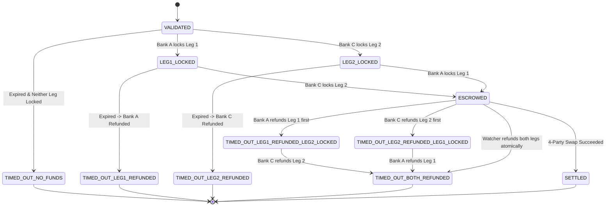

# Requirements Specification: AtomicBridge

**Title**: AtomicBridge: Cross-Border Settlement Without Blind Trust  
**Problem Statement Reference**: EkamVistar PS-02 / Syrus 7.0 FinTech PoC  
**Jurisdictions**: India & Singapore  
**Regulators**: Reserve Bank of India (RBI) & Monetary Authority of Singapore (MAS)  
**Selected Demo Token Pair**: INR and USD (Optional UI demo labels: eINR / eUSD; amounts such as ₹84M INR and \$1M USD are illustrative demo parameters)  
**Target Platform & Exact Package Status**:
- Hyperledger Fabric: **v2.5 LTS** (External Chaincode / CCaaS architecture)
- `fabric-shim`: **`2.5.6`** (installed in `app/chaincode/node_modules/fabric-shim`)
- `fabric-contract-api`: **`2.5.6`** (installed in `app/chaincode/node_modules/fabric-contract-api`)
- `@hyperledger/fabric-protos`: **`0.2.1`** (installed in `app/chaincode/node_modules/@hyperledger/fabric-protos`)
- `@hyperledger/fabric-gateway`: **Not yet installed** (pending backend initialization; target dependency for Fabric v2.5 backend is `@hyperledger/fabric-gateway` v1.x, Node.js `>=20`)
- **Code Snippet Verification Status**: TypeScript SBE and Gateway code snippets in documentation are **illustrative design snippets (uncompiled)** and have not yet been compiled or executed against the project build pipeline.

---

## 1. Executive Summary & Problem Context

### 1.1 The Herstatt Risk (Settlement Risk)
Cross-border Foreign Exchange (FX) settlements have historically been vulnerable to principal default risk, famously illustrated on June 26, 1974, when German regulators halted operations of Bankhaus Herstatt at 3:30 PM Frankfurt time. Counterparties had already settled Deutsche Marks in Frankfurt during European banking hours, but Herstatt's New York correspondent suspended outgoing US Dollar payments before the New York settlement window opened. Counterparties suffered 100% principal loss on their outgoing leg.

Modern cross-border settlement remains fragmented across disparate national payment rails, time zones, and correspondent banking intermediaries, creating multi-hour or multi-day exposure windows.

### 1.2 The AtomicBridge Objective
AtomicBridge implements a multi-jurisdictional consortium network on Hyperledger Fabric across two sovereign jurisdictions (**India** and **Singapore**) with regulatory oversight from the **Reserve Bank of India (RBI)** and the **Monetary Authority of Singapore (MAS)**.

The platform executes atomic **Payment-versus-Payment (PvP)** FX trades using tokenized central bank reserves:
- Cross-border trades settle across an **INR-token leg** and a **USD-token leg** (our chosen demo token pair: **INR** and **USD**).
- Both legs swap simultaneously within a single ledger state transition or abort completely.
- Neither participant ever ends up having paid without receiving counterparty funds.
- Timebound cryptographic escrows guarantee automated recovery if any party disconnects, defaults, or misses cut-off.

### 1.3 Source PoC Document Inconsistency Note
The source PoC documentation contains a known currency inconsistency:
- **Feature Text (Page 2, Bullet 3)** explicitly specifies: *"Atomic PvP: INR-token leg and USD-token leg swap in one transaction on a corridor channel."*
- **Architecture Diagram (Page 3)** labels the Singapore jurisdiction box as: *"SINGAPORE Own identity. Holds SGD tokens."*

**Project Decision**: We explicitly record this source discrepancy. Our selected demo token pair remains **INR/USD**, interpreting the text specification directly. (Singapore Dollar / SGD remains an architectural alternative for future corridors).

---

## 2. Consortium Topology & Roles

The system models two sovereign jurisdictions and distinct institutional member organizations across a shared consortium channel:

```
+----------------------------------------------------------------------------------------------------------+
|                                  HYPERLEDGER FABRIC CONSORTIUM CHANNEL                                   |
|                                       (`corridor-channel`)                                               |
|                                                                                                          |
|  +------------------------------------+                    +---------------------------------------+     |
|  |     JURISDICTION 1: INDIA (INR)    |                    |     JURISDICTION 2: SINGAPORE (USD)   |     |
|  |                                    |                    |                                       |     |
|  |  +------------------------------+  |                    |  +---------------------------------+  |     |
|  |  | Regulator: Reserve Bank of   |  |                    |  | Regulator: Monetary Authority   |  |     |
|  |  | India (RBI) / `RBI-MSP`      |  |                    |  | of Singapore (MAS) / `MAS-MSP`  |  |     |
|  |  | [Active Peer: peer0.rbi]     |  |                    |  | [Active Peer: peer0.mas]        |  |     |
|  |  +------------------------------+  |                    |  +---------------------------------+  |     |
|  |                                    |                    |                                       |     |
|  |  +--------------+  +-------------+ |                    |  +---------------+  +---------------+ |     |
|  |  | Bank A       |  | Bank B      | |                    |  | Bank C        |  | Bank D        | |     |
|  |  | (`BankA-MSP`)|  | (`BankB-MSP`)| |                    |  | (`BankC-MSP`) |  | (`BankD-MSP`)| |     |
|  |  | [Active Peer]|  | [Client-only]| |                    |  | [Active Peer]|  | [Client-only]| |     |
|  |  +--------------+  +-------------+ |                    |  +---------------+  +---------------+ |     |
|  +------------------------------------+                    +---------------------------------------+     |
|                                                                                                          |
|                                    +------------------------------+                                      |
|                                    |   Consortium Auditor Node    |                                      |
|                                    |   (`Auditor-MSP`)            |                                      |
|                                    |   [Client-only Identity]     |                                      |
|                                    +------------------------------+                                      |
+----------------------------------------------------------------------------------------------------------+
```

### 2.1 Role Definitions & Peer Allocation
1. **Regulator: Reserve Bank of India (RBI - `RBI-MSP`)**:
   - Sovereign authority for India and INR corridor parameters.
   - Operates dedicated peer `peer0.rbi.india`.
   - Mandatory endorsing peer for settlement transactions (`ExecutePvPSwap`).
2. **Regulator: Monetary Authority of Singapore (MAS - `MAS-MSP`)**:
   - Sovereign authority for Singapore and USD corridor parameters.
   - Operates dedicated peer `peer0.mas.singapore`.
   - Mandatory endorsing peer for settlement transactions (`ExecutePvPSwap`).
3. **Commercial Counterparty Banks**:
   - **Bank A (`BankA-MSP`)**: Operates dedicated peer `peer0.banka.india`. Pledges INR leg; endorses settlement.
   - **Bank C (`BankC-MSP`)**: Operates dedicated peer `peer0.bankc.singapore`. Pledges USD leg; endorses settlement.
4. **Client-Only Identities (No Dedicated Peer Container on Laptop)**:
   - **Bank B (`BankB-MSP`)**: Registered under India CA; transacts via `peer0.banka.india`.
   - **Bank D (`BankD-MSP`)**: Registered under Singapore CA; transacts via `peer0.bankc.singapore`.
   - **Auditor (`Auditor-MSP`)**: Registered consortium observer. Does not run a peer. Receives private audit data via an **explicitly authorized backend audit service / gateway** that queries regulator peers holding Private Data Collections; queries public channel state directly via Fabric Gateway.
5. **Consortium Expiry Watcher Identity**:
   - The automated background expiry watcher runs under an **authorized service identity within an existing regulator MSP** (`RBI-MSP` or `MAS-MSP`). It is distinguished from ordinary regulator users by a CA-issued certificate attribute: `atomicbridge.role=expiry-watcher`.
   - **Attribute Issuance**: When the watcher identity is enrolled with the jurisdictional CA, the enrollment request includes the attribute (e.g., `fabric-ca-client enroll ... --enrollment.attrs "atomicbridge.role=expiry-watcher"`). The CA embeds this attribute in the issued X.509 certificate.
   - **Chaincode Authorization**: `CancelOrRefundTrade` checks **both** conditions:
     1. `callerMSP` is `RBI-MSP` or `MAS-MSP`; **and**
     2. The client certificate contains `atomicbridge.role=expiry-watcher` (read via `ctx.clientIdentity.getAttributeValue('atomicbridge.role')`).
   - **PoC Simplification**: In the current proof-of-concept, the attribute check is **not enforced**; any client identity belonging to `RBI-MSP` or `MAS-MSP` may invoke `CancelOrRefundTrade` as the watcher. This is an explicit PoC decision. Production deployments must enable the attribute check to restrict watcher privileges to the designated service identity.

---

## 3. Endorsement Architecture vs. Client-Identity Authorization

### 3.1 Two Distinct Security Layers in Fabric
To prevent architectural confusion, we strictly distinguish the two evaluation layers:

1. **Fabric Endorsement Policy (Consensus / VSCC Layer)**:
   - Enforced by committing peers during block validation.
   - The default channel chaincode endorsement policy is:
     $$\text{Policy}_{\text{chaincode}} = \text{OR}('BankA\text{-}MSP.peer', 'BankC\text{-}MSP.peer', 'RBI\text{-}MSP.peer', 'MAS\text{-}MSP.peer')$$
   - **Crucial Rule**: This consensus policy allows **ANY ONE of those four peer organizations** to satisfy default endorsement for any key that does not have an SBE policy attached.
   - **State-Based Endorsement (SBE)**: Attached to a specific state key to override the default policy, requiring exact peer signatures (e.g., 4-party mutual endorsement on `settlement:{tradeId}`).

2. **Chaincode Client-Identity Authorization (Execution Layer)**:
   - Programmatic logic evaluated inside the TypeScript smart contract during proposal simulation using `ctx.clientIdentity.getMSPID()`.
   - **Crucial Distinction**: This check restricts **which client identity may invoke the function** (e.g. only caller identity `RBI-MSP` may invoke `MintTokens` or `SetJurisdictionRule`). **It does NOT require that client's organization peer to endorse the proposal**.
   - Under `OR(...)`, an `RBI-MSP` client could submit a `MintTokens` proposal to `peer0.banka.india`. Because `peer0.banka.india` is in the `OR` policy, Bank A’s peer signature satisfies consensus endorsement!

### 3.2 Confirmation of PoC Authorization Model
* **Intended PoC Behavior**: For `MintTokens`, `SetJurisdictionRule`, `LockTradeLeg`, and refunds, the PoC intentionally relies on the **Client-Identity Authorization Model** (`ctx.clientIdentity.getMSPID()`) evaluated under the default `OR(...)` policy.
* **Production Contrast**: If strict Fabric consensus-layer peer endorsement were required for regulatory operations, an SBE policy (`SBE(rule:INDIA) = RBI-MSP.peer`) would be installed on those keys, requiring the regulator’s peer to endorse. In the PoC, we intentionally do not attach SBE to rules or balances to avoid endorsement complexity on non-settlement paths. We do not describe client authorization as peer endorsement.

---

## 4. The Balance-Key Conflict & Key Layout Analysis

### 4.1 The Fundamental Fabric Constraint
In Hyperledger Fabric, **a state key can have at most one State-Based Endorsement (SBE) policy at any given time**.  
A key cannot have "Policy A for minting, Policy B for locking, Policy C for settling, and Policy D for refunding".

If an SBE policy were attached to a mutable balance key `balance:BankA:INR`:
- If set to `BankA-MSP.peer`: `MintTokens` by RBI would fail commit validation unless Bank A's peer also signed it.
- If set to `RBI-MSP.peer`: Bank A could not lock or burn its own tokens without RBI signing every single lock and burn transaction!

### 4.2 Resolution: Account-Based Model Selected for PoC
* **Key**: `balance:{ownerMSP}:{currency}`
* **Fabric Consensus Policy**: Default Chaincode Policy `OR('BankA-MSP.peer', 'BankC-MSP.peer', 'RBI-MSP.peer', 'MAS-MSP.peer')` (No SBE attached).
* **Chaincode Authorization**:
  - `MintTokens`: Programmatically verifies `ctx.clientIdentity.getMSPID() === 'RBI-MSP'` (or `'MAS-MSP'`).
  - `BurnTokens`: Programmatically verifies `ctx.clientIdentity.getMSPID() === ownerMSP`.
  - `LockTradeLeg`: Programmatically verifies `ctx.clientIdentity.getMSPID() === ownerMSP`.
  - `CancelOrRefundTrade`: Programmatically verifies caller is `ownerMSP` or an authorized Watcher identity under an existing channel MSP, and checks `txTimestamp >= terms.expiresAt`.
  - **Refund Amounts**: Refund values are strictly read from the immutable `trade:terms:{tradeId}` record (e.g. `terms.leg1AmountINR`, `terms.leg2AmountUSD`), never accepted as unverified user arguments. Amounts like ₹84M INR and \$1M USD represent demo trade terms.

---

## 5. Complete Timeout & Refund State Model (Approach B: Dedicated Refund Record)

### 5.1 The SBE Settlement Key Invariant
The key `settlement:{tradeId}` has a 4-party SBE policy: $\text{AND}(BankA, BankC, RBI, MAS)$.  
**Under no circumstances is `settlement:{tradeId}` modified by a unilateral timeout refund**. It permanently remains in its initial `PENDING` state.

### 5.2 Approach B: Dedicated Refund Record (`refund:{tradeId}`)
To record the final refund outcome on-ledger without touching the 4-party settlement key, we adopt **Approach B**:
* A dedicated state key **`refund:{tradeId}`** is committed by `CancelOrRefundTrade`.
* **Endorsement Policy**: Default channel policy `OR(BankA, BankC, RBI, MAS)`. No SBE attached.
* Contains the outcome record: `outcome`, `leg1Refunded`, `leg2Refunded`, `refundedAt`, `refundTxId`.

### 5.3 Complete Timeout Cases & Exact Guards



#### Detailed Case Handling:
1. **Case 1: No Legs Locked (`TIMED_OUT_NO_FUNDS`)**:
   - Condition: Trade is expired (`txTimestamp >= terms.expiresAt`), and neither `escrow:leg1` nor `escrow:leg2` is in `LOCKED` state.
   - Guard & Action: If `refund:{tradeId}` does not exist, the **first valid expired call** commits `refund:{tradeId}` with `outcome: 'TIMED_OUT_NO_FUNDS'`, `leg1Refunded: false`, `leg2Refunded: false`. No balance keys are mutated.
   - Subsequent calls: Rejected with `Error: Trade has already timed out with no funds locked (TIMED_OUT_NO_FUNDS)`.
2. **Case 2: Only Leg 1 Locked (`TIMED_OUT_LEG1_REFUNDED`)**:
   - Condition: Trade is expired; Bank A locked Leg 1; Bank C never locked.
   - Action: Bank A's locked escrow is marked `REFUNDED`; Bank A balance is credited with `terms.leg1AmountINR`.
   - Record: `refund:{tradeId}` commits with `outcome: 'TIMED_OUT_LEG1_REFUNDED'`, `leg1Refunded: true`, `leg2Refunded: false`.
3. **Case 3: Only Leg 2 Locked (`TIMED_OUT_LEG2_REFUNDED`)**:
   - Condition: Trade is expired; Bank C locked Leg 2; Bank A never locked.
   - Action: Bank C's locked escrow is marked `REFUNDED`; Bank C balance is credited with `terms.leg2AmountUSD`.
   - Record: `refund:{tradeId}` commits with `outcome: 'TIMED_OUT_LEG2_REFUNDED'`, `leg1Refunded: false`, `leg2Refunded: true`.
4. **Case 4: Both Legs Locked (`ESCROWED`) - Sequential or Atomic Refund**:
   - **Sequential Refund Order 1 (Bank A first)**:
     - Bank A refunds its own leg (`Leg 1`). `escrow:leg1` becomes `REFUNDED`, Bank A is credited `terms.leg1AmountINR`, and `refund:{tradeId}` commits intermediate outcome: `TIMED_OUT_LEG1_REFUNDED_LEG2_LOCKED`.
     - When Bank C later refunds `Leg 2`, `escrow:leg2` becomes `REFUNDED`, Bank C is credited `terms.leg2AmountUSD`, and `refund:{tradeId}` is updated to final terminal outcome: `TIMED_OUT_BOTH_REFUNDED`.
   - **Sequential Refund Order 2 (Bank C first)**:
     - Bank C refunds its own leg (`Leg 2`). `escrow:leg2` becomes `REFUNDED`, Bank C is credited `terms.leg2AmountUSD`, and `refund:{tradeId}` commits intermediate outcome: `TIMED_OUT_LEG2_REFUNDED_LEG1_LOCKED`.
     - When Bank A later refunds `Leg 1`, `escrow:leg1` becomes `REFUNDED`, Bank A is credited `terms.leg1AmountINR`, and `refund:{tradeId}` is updated to final terminal outcome: `TIMED_OUT_BOTH_REFUNDED`.
   - **Atomic Mutual Refund by Watcher**:
     - An authorized expiry watcher (see §2.1.5) can refund both legs atomically in a single call, updating both escrows to `REFUNDED` and committing `TIMED_OUT_BOTH_REFUNDED`.
   - **Watcher Handling of Partially-Refunded Trades**:
     - If the watcher finds one leg already `REFUNDED` (i.e., `refund:{tradeId}` exists with an intermediate outcome), it refunds **only the remaining `LOCKED` leg**, never crediting an already-refunded leg twice.
     - The watcher updates `refund:{tradeId}` to the final terminal outcome `TIMED_OUT_BOTH_REFUNDED`.
5. **Duplicate Refund Guard**:
   - If an individual leg is already marked `REFUNDED`, any attempt to refund that leg again is rejected (`Error: Leg is already refunded`).
   - If `refund.outcome === 'TIMED_OUT_BOTH_REFUNDED'` or `TIMED_OUT_NO_FUNDS`, subsequent calls are rejected as duplicate requests.

### 5.4 UI Status Derivation & Local Clock Disclaimer
> [!IMPORTANT]
> **Browser Local Clock Disclaimer**: Browser/client timers based on local clocks are strictly **estimates**. The UI displays an estimated countdown, but **only shows a confirmed timeout or refund status after the corresponding transaction commits on the ledger**.

The UI determines the display status in priority order:
1. If `settlement:{tradeId}` exists with `status === 'SETTLED'` $\rightarrow$ **`SETTLED`** (Ledger-Confirmed).
2. Else if `refund:{tradeId}` exists on-ledger $\rightarrow$ displays exact `refund.outcome`:
   - `TIMED_OUT_NO_FUNDS`
   - `TIMED_OUT_LEG1_REFUNDED`
   - `TIMED_OUT_LEG2_REFUNDED`
   - `TIMED_OUT_LEG1_REFUNDED_LEG2_LOCKED` (Partially Refunded; Leg 2 Pending)
   - `TIMED_OUT_LEG2_REFUNDED_LEG1_LOCKED` (Partially Refunded; Leg 1 Pending)
   - `TIMED_OUT_BOTH_REFUNDED` (Fully Refunded)
3. Else if local browser time $\ge$ `terms.expiresAt` $\rightarrow$ **`[ESTIMATED EXPIRY: Local timer elapsed; awaiting ledger refund confirmation]`**.
4. Else $\rightarrow$ displays active pre-expiry progress (`VALIDATED`, `LEG1_LOCKED`, `LEG2_LOCKED`, or `ESCROWED`).

---

## 6. Refund Caller Identities & Timestamp Trust Limitations

### 6.1 Authorized Refund Callers
`CancelOrRefundTrade(tradeId)` may be invoked exclusively by:
1. **The Depositing Commercial Bank** (`BankA-MSP` for Leg 1, `BankC-MSP` for Leg 2): Authorized to unilaterally reclaim its own locked escrow post-deadline.
2. **The Authorized Expiry Watcher**: A background service operating under an existing regulator MSP (`RBI-MSP` or `MAS-MSP`) with the certificate attribute `atomicbridge.role=expiry-watcher` (see §2.1.5). Chaincode verifies both the MSP membership and the attribute. (**PoC simplification**: attribute check not enforced; any `RBI-MSP` or `MAS-MSP` client may act as watcher.)

### 6.2 Proposal Timestamp Trust Semantics & Limitations
* **Client-Supplied Proposal Timestamp**: Fabric chaincode evaluates `ctx.stub.getTxTimestamp()`, which is extracted from the client's signed proposal header (`ChannelHeader.timestamp`).
* **No Consensus Clock**: Fabric peers do **not** provide a distributed consensus wall clock or BFT time oracle.
* **Crucial Limitation**: The proposal timestamp alone does **not independently prove real-world wall-clock expiry**. A malicious or skewed client could submit a proposal with an artificial timestamp.
* **PoC Trust Assumption**: The consortium explicitly relies on the assumption that authorized client applications (member bank backends and the authorized expiry watcher) are honest and operate system clocks synchronized via NTP.
* **Chaincode Invariant**: Chaincode strictly rejects any refund proposal where `txTimestamp < terms.expiresAt`.

---

## 7. Local Network Footprint & Resource Estimates

| Container Name | Role | Database | Estimated RAM |
| :--- | :--- | :--- | :--- |
| `orderer.corridor.example.com` | Single-node Raft Ordering Service | N/A | ~100 – 150 MB |
| `peer0.banka.india` | Endorsing Peer (`BankA-MSP`) | Embedded GoLevelDB | ~180 – 220 MB |
| `peer0.rbi.india` | Endorsing Peer (`RBI-MSP`) | Embedded GoLevelDB | ~180 – 220 MB |
| `peer0.bankc.singapore` | Endorsing Peer (`BankC-MSP`) | Embedded GoLevelDB | ~180 – 220 MB |
| `peer0.mas.singapore` | Endorsing Peer (`MAS-MSP`) | Embedded GoLevelDB | ~180 – 220 MB |
| `ca.india.example.com` | Fabric CA (India Orgs) | SQLite | ~50 – 70 MB |
| `ca.singapore.example.com` | Fabric CA (Singapore Orgs) | SQLite | ~50 – 70 MB |
| `chaincode.corridor` | CCaaS External Chaincode Server | Node.js | ~100 – 150 MB |
| **Total Docker Footprint** | **8 Lightweight Containers** | **GoLevelDB** | **~1.0 GB – 1.4 GB RAM** |

*Client-Only Identities*:
- `BankB-MSP` & `BankD-MSP`: Transact through respective jurisdictional peers.
- `Auditor-MSP`: Receives private data via backend audit service; queries public blocks via Fabric Gateway.
